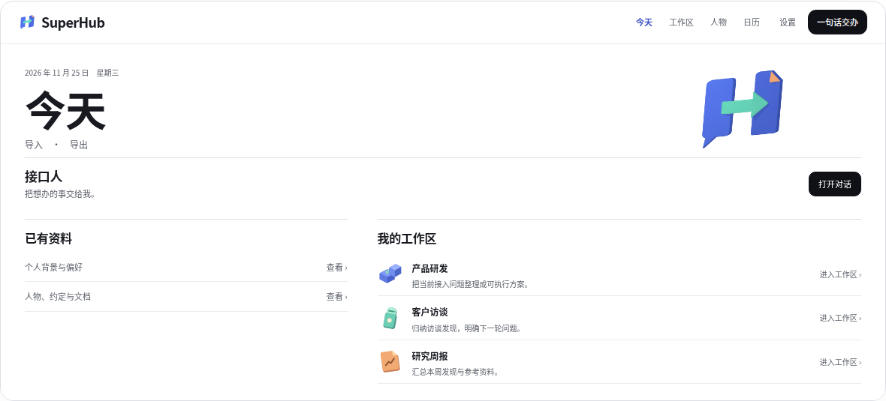
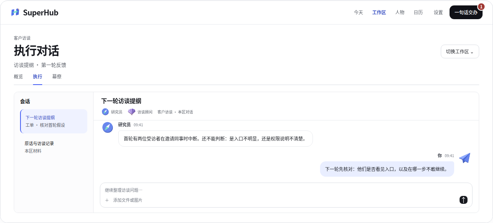
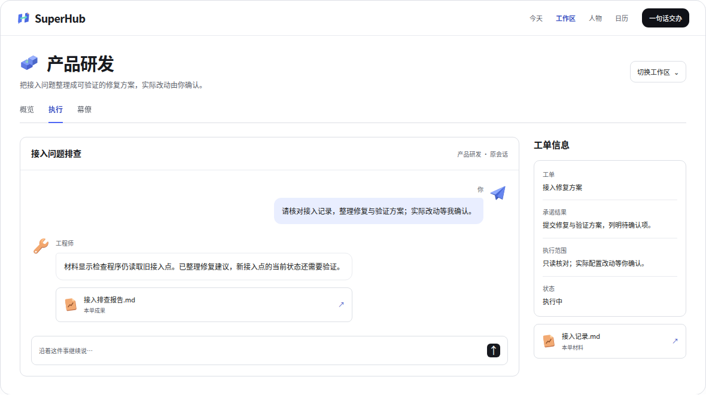
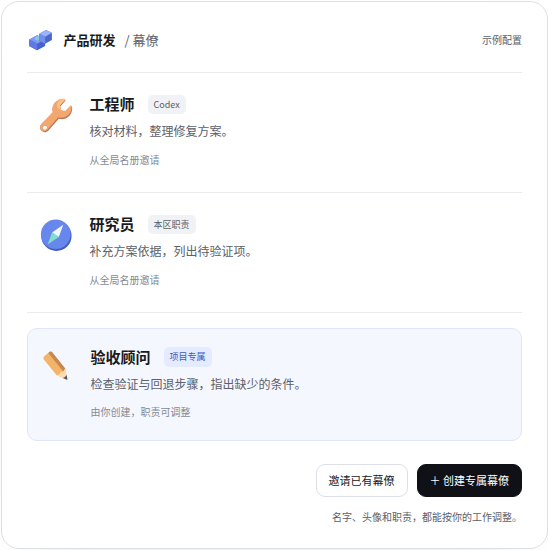
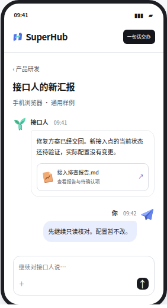
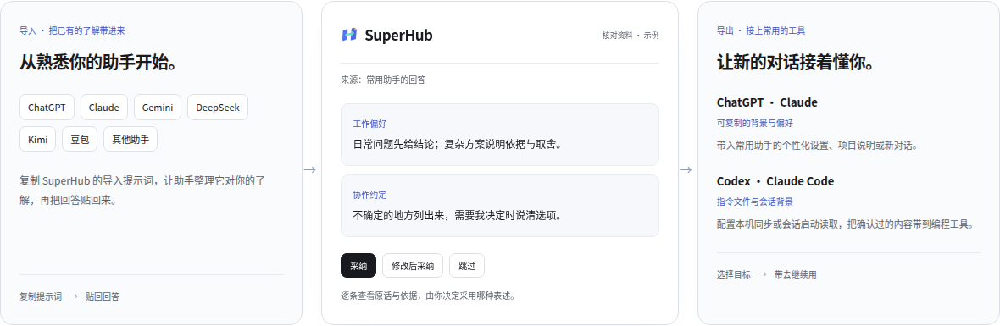

<p align="center"></p>

<h1 align="center">SuperHub</h1>

<p align="center"><strong>从一句交办，到一份交付。</strong></p>
<p align="center">让 AI 分头忙，让你专心做主。</p>

<p align="center">
  <a href="#快速开始">快速开始</a> ·
  <a href="https://codepothunter.github.io/SuperHub/">在线演示</a> ·
  <a href="https://github.com/CodePothunter/SuperHub/releases/latest">下载最新版</a> ·
  <a href="#使用工作区">工作区</a> ·
  <a href="#经验怎样积累和使用">经验</a> ·
  <a href="#导入与导出">导入与导出</a>
</p>

SuperHub 是 [DeepSeek Harness](https://github.com/deepseek-ai/deepseek-harness) 的个人 AI 工作空间。从「今天」找接口人，按项目开对话、交办工单或调整工作区配置。你可以继续手头的工作，等有空再从红点打开汇报，查看结论、补充方向，或沿原会话看过程。



*本文演示图全部使用通用虚构的项目、对话和文件。*

## 快速开始

需要 **Node.js 24+** 和 **DSH Web**。仓库以 DSH `0.2.2-rc.1` 作为打包安装与宿主回归的基准，建议同时安装 Git。

### 1. 安装 SuperHub

下载 `SuperHub-0.3.1.tgz`。在运行 DSH 的机器上，将命令里的路径换成安装包的实际位置。[SuperHub 0.3.1](https://github.com/CodePothunter/SuperHub/releases/tag/v0.3.1)

```sh
dsh plugin --profile web add /absolute/path/to/SuperHub-0.3.1.tgz
dsh web
```

GitHub Release 的安装包已包含桌面与手机端构建产物，可直接安装。

<details>
<summary>安装 DSH Web</summary>

```sh
npm install --global @deepseek-ai/dsh@0.2.2-rc.1
dsh --version
```

</details>

<details>
<summary>从源码打包</summary>

```sh
pnpm install --frozen-lockfile
npm pack
```

打包会先运行类型检查、测试和构建。安装时使用终端输出的实际 `.tgz` 文件名。

</details>

### 2. 选择第二大脑目录

1. 打开 DSH Web，在侧栏选择「SuperHub」。
2. 选择 **DSH 主机**上的第二大脑目录。新用户可以用默认的 `~/chief-brain` 或另选空目录。已有资料时使用原目录。
3. 在「今天」点「一句话交办」，说清目标、材料和完成标准。也可以创建工作区，与本区成员直接沟通。

旧版资料可从「今天 → 导入 → 从上一版 SuperHub 导入」接入。导入后可在「今天 → 已有资料」查看。

<details>
<summary>检查安装与使用包内 CLI</summary>

在已安装插件的目录运行 `node bin/cli.mjs doctor`。

若宿主使用自定义 `DSH_HOME`，请在终端使用相同的配置。`doctor` 会显示第二大脑和运行环境。安装或升级之后，按宿主提示重启或刷新页面。

</details>

## 从一句交办开始

1. 在「今天」点**一句话交办**，说清目标和边界。例如「我先继续客户访谈。请核对产品研发的接入问题，给我修复与验证方案，实际改动等我确认。」
2. 接口人把任务交到对应工作区，回执带你找到原工单。团队在项目里核对材料、讨论和交付，你可以回到访谈继续工作。
3. 有新回复或汇报时，「一句话交办」会显示未读红点。你可以先把眼前的话写完，再打开汇报。红点清除代表已读，工单状态单独记录。
4. 先读结论与待确认项，再决定是否查看原会话。补一句方向后可以回到刚才的访谈，接着写原来的提纲。



接口人窗口按长时间对话设计：桌面上是宽幅窗口，手机上占满整屏。长对话打开时停在最新消息，只加载最近一段；向上滚动会自动加载更早的消息，阅读位置保持不动。从汇报或交付打开原话时，直接定位到那条消息，上下都能继续翻。

### 去指定工作区开聊

在「今天」对接口人说「在产品研发工作区开个对话，不用开工单。问一下发布前看哪几个指标，异常时怎么回退？」接口人找到对应工作区，另开一场群聊并送出原问题。这次新增 **1 场对话、0 张工单**。点「打开对话」可查看原问题和本区成员的回复。也可以指定已有会话，把新问题送到原处。

接口人可以按名称、目标或负责人查找工作区。重名时，它会列出区别，等你选定。接着说「就启动吧，带工单也行」，接口人可以沿用上轮的目标和问题。若问题已经送达，回执会带你回到同一场对话。要限定交付约定和验收标准时，可以明确请它开工单。

这些工作区操作可从当前源码构建体验。[在线示例](https://codepothunter.github.io/SuperHub/#liaison-demo) · [工作区路由图解](https://codepothunter.github.io/SuperHub/superhub-design.html#workspace-routing)

### 到点提醒：定时安排

对接口人说「每周一到周五上午 9:00 提醒我各工作区尚未关闭的工单」，它会建立一条定时安排。回执写明下一次时间、提醒出现在哪里、是否推送到手机。

- **只有一个去处。** 到点后，提醒出现在「一句话交办」的对话里并计入未读红点。配置了推送地址时同时推送到手机，晚上 10 点半到早上 8 点的推送留到早上。
- **集中管理。** 所有安排都在「设置 → 定时安排」，可以查看下一次时间和上一次结果，也可以停用或删除。提醒下方也能直接停用。
- **内容按实际数据生成。** 未关闭工单汇总直接读取各工作区的工单，不经模型改写。早报、晚报由接口人依据工单和日程撰写，两者默认关闭，需要时在设置里打开。每周经验整理默认每周日 20:00 运行。
- **出错会说明。** 生成失败时每隔 10 分钟重试，三次仍失败才在对话里说明原因，设置里同时显示结果。

## 使用工作区

**每个项目，都有自己的工作现场。** 工作区可以记录当前目标和绑定项目目录。「概览」按会话列出工单，「执行」可以打开原对话、继续发言或用 `@名字` 叫一位本区成员。打开工单可查看约定、范围与成果，并在原对话里找到交办和材料。仍在推进的工单可以暂停、恢复或收窄范围。

例如，产品研发保留接入排查的记录与验证方案，客户访谈保留原话与下一轮追问。回来时从本区的会话与工单接上。工作区的「经验」页集中查看共同做法，幕僚自己的成长记录留在「幕僚」页。

项目的日常配置也可以从接口人聊天发起。例如「把产品研发的目标改成每周复盘发布质量」「把刚才那个工作区改名为发布保障」。还可以绑定、更换或解除项目目录，以及查询、创建和调整本区专属幕僚。接口人会说明实际改了哪个工作区和哪些字段。归档、恢复和删除在对应页面操作。



### 你的团队，由你来组

在工作区的「幕僚」页，可以邀请全局名册里的成员并为这个项目设置职责，也可以创建专属幕僚，自己定名字、头像、职责和执行方式。打开成员卡的「成长记录」可查看他从哪些工作中学到了什么，并核对来源。

专属幕僚可以由 DSH 模型执行（可指定模型与思考深度，不指定时沿用接口人的模型），也可以交给 Codex 或 Claude Code。创建或「编辑职责」时选择，改动从下一次在群里叫他时生效。全局名册的成员按各自的全局角色卡执行。也可以直接对接口人说，在私聊或这个工作区的群里都行，例如「给这个工作区加一个六爻卦师，模型用 gpt 6.1 sol，思考深度 high」「把工程师改成 Codex」。在群里，接口人只认你本人在群里说的话，只能管本工作区的幕僚。可用的工具、模型和账号由主机环境提供。

群里需要你拍板时，接口人会提一条待回应，首页和右上角都会提示。点「回应」写下的回复就算答复了，提示随即消失，接口人接着办；如果答复还不够，它会另提一个新问题。



### 经验怎样积累和使用

交付、阶段回报和失败后的恢复可以留下可复用的经验。每条经验保留适用情境、边界和依据。你明确提出的长期要求会按适用范围生效。原始交付或真实测试能直接核实的事实，可以按当时的条件自动采纳。

**从工作结果归纳出的做法，有两个独立工单的原始材料印证后可以自动采纳。** 同一工单的群消息、回报和重试只算一份。整理可随新结果运行，也可通过「现在整理」或「设置 → 定时安排」里的每周经验整理（默认周日 20:00）执行。证据不足的建议会保持「待采纳」，你可以查看它还缺什么，自行决定是否采纳。

到达明确期限或适用前提被替代时，系统自动停用旧版。新证据能确定改法时自动更正。同一条件下的依据相互冲突时，相关经验会暂停，等你裁决。长期低频使用的经验只提示复核，仍可参考。

工作区「经验」页展示共同经验，「幕僚 → 成员 → 成长记录」展示专属经验。卡片标明「自动采纳」「自动更正」「自动过期」等操作方式，打开「查看依据」和「历史版本」可核对来源、理由与旧版。你仍可手动采纳、更正、停用或恢复有效的旧版。可用经验才会按权限和任务相关性提供给执行成员，换模型后仍沿用同一条记录。

经验默认保留在原工作区。需要跨区复用时，由你选择共享文字、接收范围、用途和有效期。这个有效期控制接收方的使用授权，条目的状态仍在来源区管理。接收方只看到获准的摘录。共享撤回或来源停用后，后续任务会重新核对可用版本。

### 在手机上接着做

已登录 DSH Web 时，可以打开同一站点的 `/chief/m/`。也可以在桌面的「设置」启用独立手机访问并设置密码，再从手机浏览器打开显示的地址。独立端口使用 HTTP，跨公网访问时请配置 HTTPS 反向代理。



## 导入与导出

换个工具，默契不用从零开始。在「今天 → 导入 → 从别的助手导入」复制提示词，发给你常用的助手，再把它对你的了解贴回来。在「核对资料」逐条查看原话和依据，选择采纳、修改后采纳或跳过。也可以把回答交给接口人，从回执进入核对页。

「导出」会整理你已确认的本人资料、协作约定与当前有效目标。文本可以带到 ChatGPT 或 Claude。本机的 Codex、Claude Code 可按导出页说明配置指令文件或会话启动背景。标记为 `[机密]` 的内容会被过滤。



## 为什么这样设计

交办有去处，继续手头的事时知道去哪里找进展。工作区保存过程，未读汇报留在统一入口。「今天」保留项目与交付的全局视图，让你可以重新决定下一步该关注什么。这套设计借鉴了注意力残留、目标记忆与局势感知研究。[设计说明与参考资料](docs/attention.md)

## 你可能想知道

### SuperHub 和 DS Bot、Personal Agent 有什么区别？

**SuperHub 的优势在于多项目并行时，每个项目都能接着做，你也能按自己的节奏接回汇报。** 一个工作区把同一项目的多场会话、多张工单、成员职责和交付放在一起。幕僚可以跨项目复用，项目上下文各自积累。你从统一入口接回各项目的汇报，再决定什么时候深入哪一件事。

例如，你正在整理客户访谈，产品接入检查突然失败。你要交出一项排查，拿到修复和验证方案后再决定是否改动。

- **DS Bot 围绕 Bot 和群聊组织协作。** 在研发群交办，群管理员召集工程和验证 Bot，结果发回群里。这个群有自己的记忆和工作目录，也可以从任务页看后台进度。[DS Bot 功能说明](https://github.com/Fei-Craft/DS-Bot#features)
- **Personal Agent（以「搭档」为例）围绕一个助手和它接下的工单组织工作。** 把排查交给搭档，它开单并在工单的会话和目录里执行。你从原交办入口接回结果，或从面板和日报回看。[「搭档」项目说明](https://github.com/yinguobing/dsh-personal-agent)
- **SuperHub 围绕长期项目工作，汇报集中给你。** 在「一句话交办」说清目标和改动边界，接口人把排查放进「产品研发」，由本区幕僚分工。

**工作区上下文隔离，让项目可以续做。** 今天有接入排查，明天可以另开会话做发布核对。做发布核对时，从研发工作区就能找到上次的报告、已做的验证和还待确认的决定。即使两边用同一位研究员，他在研发核对配置与验证依据，在访谈核对受访者原话。研发积累的本区经验留在研发。想把其中一条方法用到访谈时，可以只共享那段文字。

**注意力管理，让你少为跟进切换项目。** 方案交回时，你还在访谈里写提纲。「一句话交办」的红点留住未读汇报。你可以先写完这一段，再看接口人归纳的结论和待确认项。要决定是否改配置，从汇报进原工单核对依据。需要盘点几条主线时，回「今天」一起看各项目的交付。

[在在线演示里走一遍这个用例](https://codepothunter.github.io/SuperHub/#story-sequence)

## 体验在线演示

[打开 SuperHub 演示](https://codepothunter.github.io/SuperHub/)。用滚轮或左右方向键推进协作场景。也可以在工作区预览点击「一句话交办」，发送示例消息，从回执打开普通对话。切换「产品研发」「客户访谈」「研究周报」可查看不同项目的工单、材料、共同经验与幕僚成长记录。演示使用内置样例。

[查看 SuperHub 机制图解](https://codepothunter.github.io/SuperHub/superhub-design.html)。八张图说明跨工作区开聊、交办、注意力管理、工单、工作区边界、经验记忆和权限。

从源码预览时，在仓库根目录运行 `python3 -m http.server 8080 --bind 127.0.0.1 --directory site`，再打开 [本地演示](http://127.0.0.1:8080/)。

## 数据存放

业务记录保存在所选第二大脑目录。工作区记录位于 `ops/superhub-v2/`，会话来源位于 `ops/superhub-v2-dialogues/`，经验和整理记录分别位于 `ops/superhub-staff/` 与 `ops/superhub-experience-learning/`，定时安排位于 `ops/superhub-schedules.json`。每场会话有单独的 `work/superhub-v2/` 子目录。第二大脑位置、接口人会话和手机访问设置保存于 DSH 主机的 `$DSH_HOME/chief/`。执行时，任务所需内容会交给你配置的模型服务商。

## 开发

```sh
pnpm install --frozen-lockfile
pnpm check
pnpm smoke
```

- [src/core](src/core) 与 [src/dsh](src/dsh) 包含工单、运行时和执行器适配。
- [src/client](src/client) 与 [src/mobile](src/mobile) 包含桌面和手机页面。
- [site](site) 包含独立静态落地页和通用演示素材。
- [注意力设计](docs/attention.md) · [CI 回归入口](.github/workflows/check.yml)

## 许可

[MIT](LICENSE) · [第三方声明](NOTICE)
